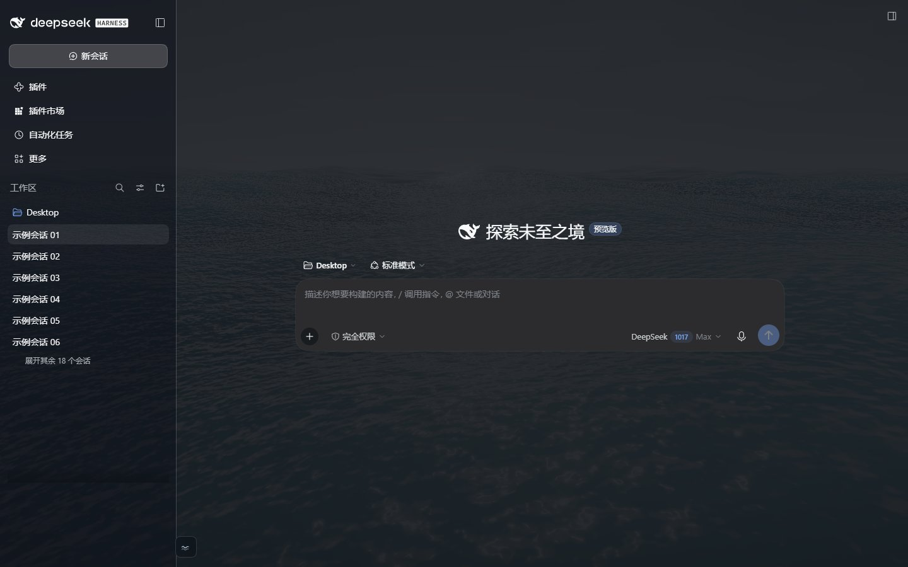

# DSH Remote Kit（DeepSeek Harness 手机远程套件）

让 **iPhone 扫码就能远程使用家里/办公室电脑上的 DeepSeek Harness**：
Windows 一键启动器 + 自建 Relay + 加密隧道 + 手机端抽屉 UI，整套东西都在这个仓库里。

> 这是我自己在用的一套远程方案，不是 DeepSeek 官方产品。
> 前提是你有一台常开的 Windows 电脑装 DSH，并且愿意自己部署（不需要买服务器）。

| 手机聊天页 | 手机抽屉 | 手机插件页 | 桌面端完全不受影响 |
| --- | --- | --- | --- |
|  |  |  |  |

## 为什么要做这套东西

DeepSeek Harness 桌面版很好用，但官方没有“人在外面，用手机接着用家里电脑”的能力。
已有的方案要么依赖别人的中转服务，要么手机上打开就是桌面布局——侧边栏挤着对话区，输入框小小一个，根本没法用。

所以我把整套链路自己搭了一遍：

- **配对**：电脑上控制页显示二维码，iPhone 相机一扫就进；
- **连接**：Cloudflare Quick Tunnel 打洞，不需要公网 IP、不需要开路由器端口；
- **加密**：手机和电脑之间是端到端加密隧道（`sealed-tunnel-v1`），中转服务器只看到密文和路由信息；
- **启动**：Windows 双击一下，隧道、Relay、工作区、防休眠全部拉起来；
- **界面**：给手机窄屏补了抽屉布局，对话区铺满屏幕，桌面端完全不动；
- **稳定**：支持开机自启、防休眠，想固定地址可以换 Tailscale Funnel 或 Cloudflare 命名隧道。

自己用了一段时间，真机（iPhone + Win11）跑通后整理开源。它不是 SaaS，也不会替你做托管——**服务器就是你的电脑**。

## 这套系统由什么组成

| 组件 | 目录 | 作用 |
| --- | --- | --- |
| 一键启动器 | [`launcher/`](launcher/) | Windows 入口：启动 cloudflared + Relay + DSH 工作区，控制页、配对码、防休眠、自启、固定地址 |
| Relay 中继 | [`relay/`](relay/) | 基于 [dsh-relay](https://github.com/april-jk/dsh-relay)（MIT）的适配版：设备配对、加密隧道、Web 客户端、手机 UI 注入 |
| DSH 插件 | [`plugin/`](plugin/) | 基于 [dsh-mobile-plugin](https://github.com/april-jk/dsh-mobile-plugin)（MIT）的适配版：在 DSH 里提供远程访问能力和 desktop host-auth |
| 桌面桥接 | [`desktop-bridge/`](desktop-bridge/) | 可选：让你的**日常 DSH 桌面实例**接入远程访问，而不是另起一个工作区 |
| 手机 UI | [`relay/web/app/mobile.css`](relay/web/app/mobile.css)、[`relay/web/app/mobile.js`](relay/web/app/mobile.js) | 窄屏抽屉布局，由 Relay 的 Service Worker 注入 |
| 测试 | [`tests/`](tests/) | 34 项手机/桌面布局回归 + 部署检查 + 脱敏截图生成 |
| DSH 插件面板（可选） | [`panel-plugin/`](panel-plugin/) | 在 DSH 设置页里启停 kit、查看状态、打开配对控制页 |

## 工作原理

```text
 iPhone Safari（扫码配对）
        │  HTTPS
        ▼
 公网入口：Cloudflare Quick Tunnel / Tailscale Funnel / 命名隧道
        │  只转发 TLS 与密文
        ▼
 本机 Relay  http://127.0.0.1:8788   ←  「一键启动器」负责拉起和配置
        │  加密 WebSocket（sealed-tunnel-v1，端到端加密）
        ▼
 DSH 桌面端 + @april-jk/dsh-mobile 插件（或独立的远程工作区）
        │
        ▼
 你的对话、文件、工具 —— 都在你自己电脑上
```

- 手机和电脑各持一把密钥，配对码里只带一次性凭据；Relay 负责转发**密文**，看不到对话内容。
- 手机打开的是 Relay 的 `/app/` 页面，登入后通过加密隧道拿到 DSH Web UI；手机 UI 的 CSS/JS 也由 Relay 的 Service Worker 注入。
- 更细的配对/加密流程见 [`docs/architecture.md`](docs/architecture.md)，安全边界见 [`docs/security.md`](docs/security.md)。

## 快速开始（Windows）

> 完整步骤、常见报错见 [`docs/quickstart-windows.md`](docs/quickstart-windows.md)。

前置：

- Windows 10/11，已安装 **DeepSeek Harness 桌面版**（默认路径 `%LOCALAPPDATA%\Programs\DeepSeek Harness`）
- Node.js LTS（启动器默认用 `%ProgramFiles%\nodejs\node.exe`）
- 一台 iPhone（Safari 15.4+）

```powershell
git clone https://github.com/ln123456789100ln-collab/dsh-remote-kit.git
cd dsh-remote-kit

# 1) 下载 cloudflared（版本必须匹配，启动器会校验 SHA256）
curl.exe -L -o tools\cloudflared.exe https://github.com/cloudflare/cloudflared/releases/download/2026.10.3/cloudflared-windows-amd64.exe
Get-FileHash tools\cloudflared.exe -Algorithm SHA256   # 应等于 tools\README.md 里的值

# 2) 构建 Relay
cd relay
npm ci
npm run build
cd ..

# 3) 启动
launcher\Start-All.vbs
```

启动后浏览器会自动打开本机控制页 `http://127.0.0.1:30889`：

1. 点“显示配对码”，用 iPhone 相机扫码；
2. 手机首次进入后**刷新两次**（第一次装 Service Worker，第二次应用手机 UI）；
3. 想停止：控制页“停止并退出启动器”。

想固定地址（不再每次重启换隧道域名）：看 [`docs/fixed-relay.md`](docs/fixed-relay.md)。
想让远程连接**日常桌面 DSH 实例**而不是独立工作区：看 [`docs/desktop-mode.md`](docs/desktop-mode.md)（可选，属于进阶用法）。

## 功能清单

- 扫码配对，手机浏览器直接使用，不需要装 App。
- Cloudflare Quick Tunnel 打洞，无需公网 IP、无需端口映射；也可换 Tailscale Funnel / 命名隧道固定地址。
- 端到端加密隧道，Relay 只做密文转发；设备密钥只存在手机浏览器 IndexedDB 和电脑本机。
- 手机窄屏抽屉 UI：52px 顶栏、78vw 抽屉、会话本地过滤、输入区整宽、safe-area 适配、非聊天页不被顶栏遮挡。
- 桌面端零改动（所有样式限定在 `max-width: 720px`）。
- Windows 一键启动：cloudflared → Relay → 工作区自动串联，控制页管理启停与配对。
- 防休眠、开机自启脚本。
- Relay 侧 gzip + 版本化静态缓存 + 手机轻量资源，冷启动加载明显更快。
- 可选桌面模式：远程操作日常 DSH 实例（历史对话、插件、文件都在）。

## 安全与隐私

- 所有凭据（`controller.json`、`remote.json`、Relay 数据库、JWT、配对二维码内容）只存在电脑本机 `%USERPROFILE%\.dsh-remote`，**不在这个仓库里**。
- Relay 只看到路由元数据、密文大小和时序；对话内容由手机和电脑端到端加密。
- 手机访问链接里带一次性配对凭据，别把二维码/链接转发给别人；用完可以撤销配对。
- 这个仓库不含 `cloudflared.exe`、DSH 安装包、任何设备密钥或真实会话截图（文档截图已脱敏）。
- 详细威胁模型和自检清单：[`docs/security.md`](docs/security.md)。

## 已知限制

- **启动器只有 Windows 版**；macOS/Linux 需要自己手动跑 Relay + 插件（协议是通的，但没有打包入口）。
- 手机 UI 依赖 DSH Web 的 CSS Module 类名（带哈希）。**DSH 升级后可能失效**，届时跑 `tests/mobile-check.cjs` 定位。
- Cloudflare Quick Tunnel 每次重启换域名，手机需要重新扫码；要固定地址得用 Funnel/命名隧道。
- 配对、加密、Relay 协议是上游项目设计的；本项目是适配和整合，安全强度取决于上游实现，**没有做过正式安全审计**。
- 项目是个人自用整理，测试覆盖偏本机环境（iPhone + Win11 + DSH 桌面版），不保证所有版本/网络环境通用。
- 这个方向已经有很多同类项目（更成熟的有 JochenYang/dsh-remote、@linxin666/dsh-remote-web-ui 等）；做上架或重构前先看 [docs/related-projects.md](docs/related-projects.md)，避免重复造轮子。

## 仓库结构

```text
launcher/          Windows 一键启动器（Node + VBS + PowerShell）
relay/             适配版 dsh-relay（TypeScript，MIT）；web/app 内含手机 UI
plugin/            适配版 @april-jk/dsh-mobile（MIT）
desktop-bridge/    可选：日常 DSH 实例的本地桥接插件
tests/             手机/桌面布局回归、部署检查、截图脚本
docs/              架构、快速开始、安全、排错、固定地址、手机 UI、同类项目对比
tools/             cloudflared 放置位置（二进制不入库，见 tools/README.md）
vendor/            适配版插件 npm 包（launcher / desktop-bridge 共用）
assets/screenshots 脱敏截图
```

## 测试

```powershell
cd tests
npm install
npm run test:mobile     # 需要本机 DSH 桌面端在运行（34 项断言）
node live-sw-check.cjs https://你的relay地址
```

`npm run screenshots` 会重新生成 README 截图，并自动把会话名/头像/余额/模型名打码。

## DSH 插件面板（可选，Phase 1）

不想每次去双击启动器的话，可以装这个配套插件：在 DSH 设置页里直接看远程状态、启停 kit、打开配对控制页。

```powershell
dsh plugin --profile web add https://github.com/ln123456789100ln-collab/dsh-remote-kit/releases/download/panel-v0.1.0/dsh-remote-kit-panel-0.1.0.tgz
```

装完刷新 DSH → **设置 → 插件配置 → 远程访问（Kit）**，填一下 kit 目录（例如 `C:\dsh-remote-kit`）就能用。

说明：

- 它只是控制面板，远程协议、配对、加密和手机 UI 仍由本 kit 提供；需要先按上面的步骤把 kit 装好。
- 目前仅支持 Windows、DSH >= 0.2.0-rc.1；源码与开发说明见 [`panel-plugin/`](panel-plugin/)。
- 这个插件目前是"配套面板"形态（Phase 1）；把它做成完全自包含（插件内自带 relay + cloudflared）是下一步。

## 许可证与致谢

- 本项目使用 [MIT License](LICENSE)。
- Relay 与插件分别来自 [april-jk/dsh-relay](https://github.com/april-jk/dsh-relay) 和 [april-jk/dsh-mobile-plugin](https://github.com/april-jk/dsh-mobile-plugin)（均为 MIT），适配改动和版权声明见 [NOTICE.md](NOTICE.md) 与各目录下的 `LICENSE` / `FORK-NOTES.md`。
- DeepSeek Harness 是 DeepSeek 的产品，本项目与官方无关，也不分发 DSH 本体。
- 如果这套东西帮你省了折腾的时间，点个 star 就好；遇到问题欢迎开 issue。
