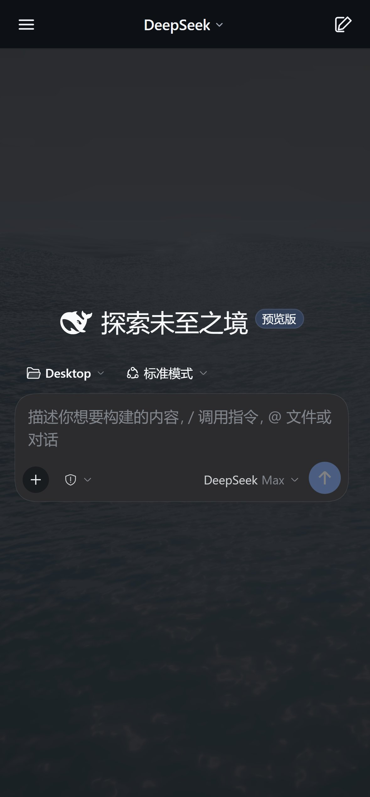
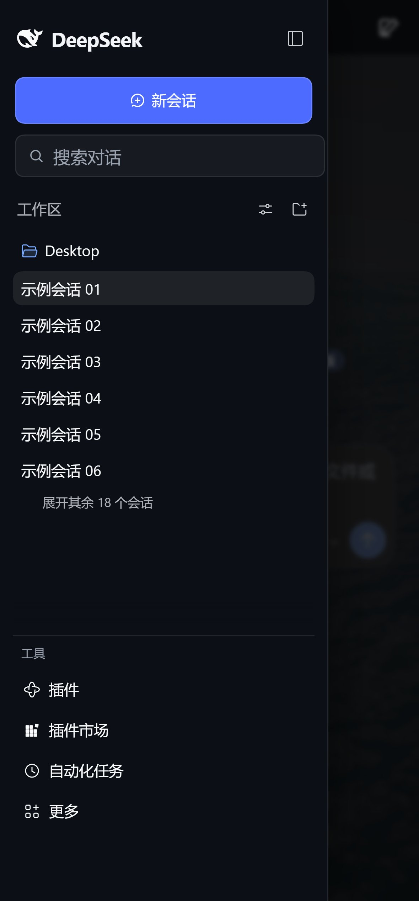
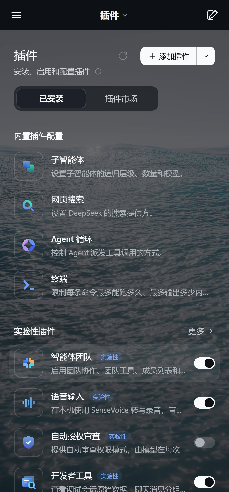

# DSH Mobile Drawer UI

给 **DeepSeek Harness 手机远程页面**（[dsh-relay](https://github.com/april-jk/dsh-relay) 的浏览器端）补一套窄屏布局：
顶部标题栏 + 滑入式抽屉 + 全宽聊天区。桌面端一根手指都不碰。

> 这是我个人给自己用的小补丁，不是 DeepSeek 官方项目，也没打算做成大而全的框架。
> 它只改 Relay 的浏览器端静态资源和 Service Worker，不碰 DSH 本体，不碰账号、密钥或你的会话数据。

## 先说为什么要做这个

在 iPhone 上打开 DSH 远程页面时，原来的 56px 侧边栏一直占着左边，对话区被挤得又窄又长，输入框也是小小的一个。
用起来就像在手机上硬塞了一个桌面布局——能用，但说不上舒服。

我翻了一圈上游的 relay 和 plugin 仓库，没找到现成的窄屏方案，于是趁着周末自己写了一版：
把侧边栏收进抽屉、聊天区铺满屏幕、输入框整宽、顶部只留一条 52px 的小标题栏。
顺手还修了一个自己用着很难受的 bug：插件页和插件市场的内容会被固定顶栏压住半行。

真机（iPhone）上用下来效果还行，所以把代码整理出来开源。如果你也在手机上用 DSH 远程，应该能少走一点弯路。

| 手机聊天页 | 手机抽屉 | 插件页（顶栏不再吃内容） | 桌面端不受影响 |
| --- | --- | --- | --- |
|  |  |  |  |

## 它到底改了什么

- **手机窄屏**：隐藏原来的侧栏轨道，聊天区占满全宽。
- **顶部固定 52px 标题栏**：左边菜单、中间标题（会话名 / 当前页面名）+ 下拉箭头、右边新对话；刘海屏的 safe-area 也处理了。
- **侧边栏变成抽屉**：宽度 `min(78vw, 340px)`，带半透明遮罩和滑入动画；点遮罩、按 Escape、选中会话后自动关闭。
- **抽屉里还是你熟悉的 DSH 侧边栏**：品牌、蓝色新会话、搜索、工作区/会话列表、工具、账号，一个都没少。
- **搜索框就地过滤**：输入时只过滤已经加载出来的会话标题，无结果会提示“没有匹配的对话”。
- **输入区整宽、字号 16px**（避免 iOS 聚焦时自动放大），底部 safe-area 也留出来了。
- **插件 / 插件市场 / 自动化任务这些非聊天页**：自动避开固定顶栏，内容不再被压住；顶栏标题也会跟着页面变。
- 移动端顺手藏掉了重复的品牌名、余额卡和“海洋皮肤”浮动按钮。
- **桌面端没有变化**：所有样式都包在 `max-width: 720px` 里，1440 和 721 宽度下布局和原来一致。

## 适合谁 / 不适合谁

**适合**：已经有一套能用的 DSH 远程 Relay（`dsh-relay` 那套 Web 客户端），想在手机上用得更舒服一点，也愿意自己动手替换一个 `sw.js` 的人。

**不适合**：想要开箱即用的 App、不想碰命令行、或者希望它跟 DSH 官方升级永久兼容的人——DSH 是闭源的，Web UI 一升级，类名可能就变了，这个补丁有可能某天突然失效。这是它的命门，我提前说清楚。

## 装到自己的 Relay 上

前提：一个已经跑起来的 DSH 远程 Relay，以及和本仓库兼容的 DSH 版本（见下面的“兼容性”）。

```bash
git clone https://github.com/ln123456789100ln-collab/dsh-mobile-drawer.git
cd dsh-mobile-drawer

# 1. 把 CSS/JS 内嵌进 sw.js
node scripts/build-mobile-sw.cjs
node --check app/sw.js

# 2. 备份你的 Relay 里的 web/app/sw.js，然后用刚生成的 app/sw.js 替换它
#    同时把 app/mobile.css、app/mobile.js 一起放到 Relay 的 web/app/ 下（方便排查和版本对照）

# 3. 按你自己的方式重启/重新部署 Relay 的静态服务
```

然后手机打开 Relay，**刷新两次**：第一次装新的 Service Worker，第二次才会应用注入的界面。

如果你的 Relay 和参考实现差得比较多（比如没处理 CSP、静态文件结构不一样），看 [`docs/integration.md`](docs/integration.md)——其实就三处改动：

1. 在 SW 顶部内嵌 `MOBILE_CSS` / `MOBILE_JS`，定义注入标签；
2. 代理到 HTML 响应时，把 `<link>` 和 `<script>` 插到 `<head>` 里；
3. 在 `fetch` 事件最前面，由 SW 直接返回 `/app/mobile.css` 和 `/app/mobile.js`。

Relay 的静态服务器没有这两个路由很正常（直接 curl 会 404/426），资源只走 Service Worker。

## 踩过的几个坑（写出来省得你再踩）

- **固定顶栏会盖住非聊天页**：聊天页有 `.an3WzG_header` 占位，插件页没有，内容从 y=0 开始，于是被顶栏吃掉 52px。现在的做法是给这类页面统一补 `padding-top`。
- **Relay 静态服务器不认 `/app/mobile.css`**：所以在 SW 里把 CSS/JS 内嵌，由 fetch 直接吐出来，不依赖服务端新增路由。
- **CSP meta 会拦注入的内联脚本**：参考实现会把代理 HTML 里的 CSP meta 去掉（这是上游 relay 已有的行为，不是这次加的）。
- **手机要刷两次**：新 SW 装好后由 `skipWaiting` + `clients.claim` 接管，但当前页面的 CSS/JS 还是旧的，需要再次导航才换成新的。

## 验证方式

```bash
cd tests
npm install

# 布局回归：需要本机 DSH 桌面端在运行（读取 ~/.dsh-remote/desktop-host.json），
# 会把真实页面注入测试，覆盖移动 393×844 + 桌面 1440/721，共 34 项断言
npm run test:mobile

# 部署检查：验证你的 Relay 域名上 SW 和资源是否真的生效
node live-sw-check.cjs https://your-relay.example.com
```

`npm run screenshots` 可以重新生成 README 里的截图（会自动把会话名、头像、余额、模型名打码或隐藏）。

## 兼容性和已知限制

- 适配基线：DSH 桌面版 `app.asar` 时间戳 **2026-10-23 16:00**；Relay 参考实现基于适配版 `dsh-relay` 0.1.9，UI 版本 `mobile4`。
- DSH 升级后如果顶栏/抽屉失效，先跑 `tests/mobile-check.cjs`，失败项会告诉你哪个 CSS Module 类名不匹配了。
- 手机上需要刷新两次才会看到新版本；旧页面会一直用旧样式直到刷新。
- 搜索只是**已加载会话标题的本地过滤**，不是 DSH 全量搜索。
- 抽屉没有左滑关闭手势；消息区还是 DSH 原样（头像、消息卡片这些没动）。
- iOS 需要 Safari 15.4+（用到了 `dvh` 和 `env(safe-area-inset-*)`）。
- 本仓库只负责“显示层”。配对、加密、隧道这些都在 Relay 项目里，不在本仓库范围。

## 隐私和安全

- 仓库里**没有** `cloudflared.exe`、DSH 安装包、Relay 后端、任何设备密钥/二维码/JWT/数据库。
- `mobile.js` 不读 `localStorage`/IndexedDB/令牌，也不发起任何网络请求。
- 截图经过脱敏：会话名换成“示例会话 01…”，头像、余额、模型名都隐藏或替换了；图片本身也没有 EXIF 信息。
- 安装步骤里需要你自己准备 Relay；本仓库不提供现成的公网服务。

## 致谢和 License

- 注入思路和 `sw.template.js` 基于 [april-jk/dsh-relay](https://github.com/april-jk/dsh-relay)（MIT）和 [dsh-mobile-plugin](https://github.com/april-jk/dsh-mobile-plugin)（MIT），版权声明见 [NOTICE.md](NOTICE.md)。
- 本项目用 [MIT License](LICENSE) 开源。如果你改了它、想合并回上游，欢迎顺手给上游项目提个 issue 或 PR。

如果它帮你省下了一个下午，点个 star 就好；用坏了也欢迎开 issue，我尽力修（但不保证每次都修得动 😅）。
